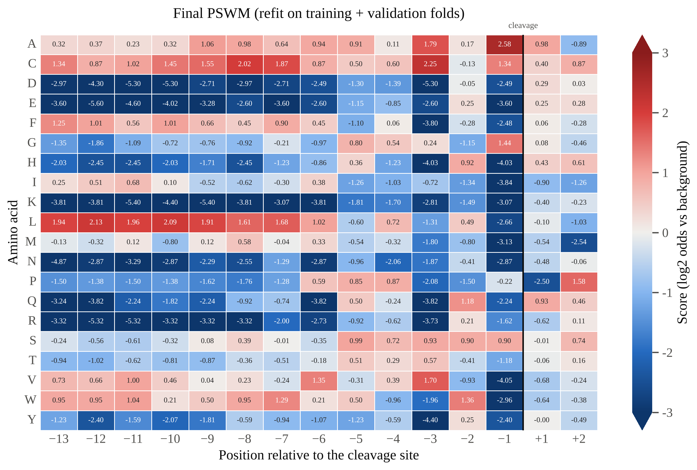
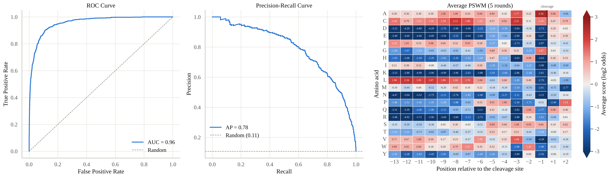
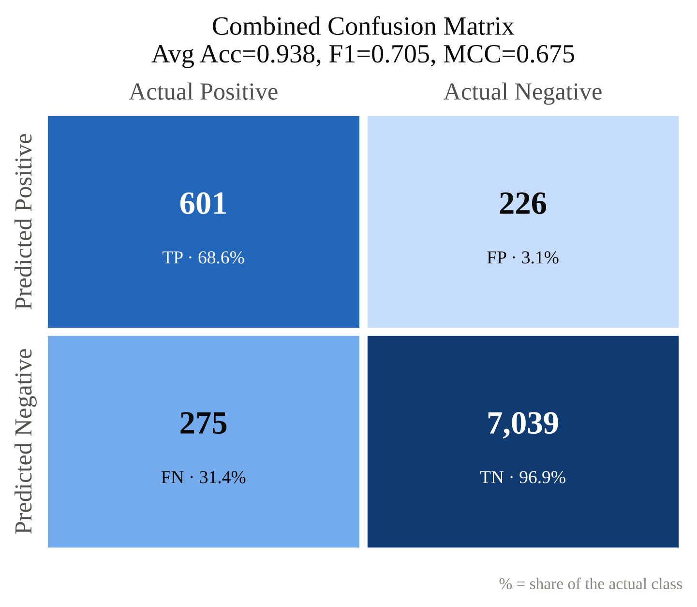
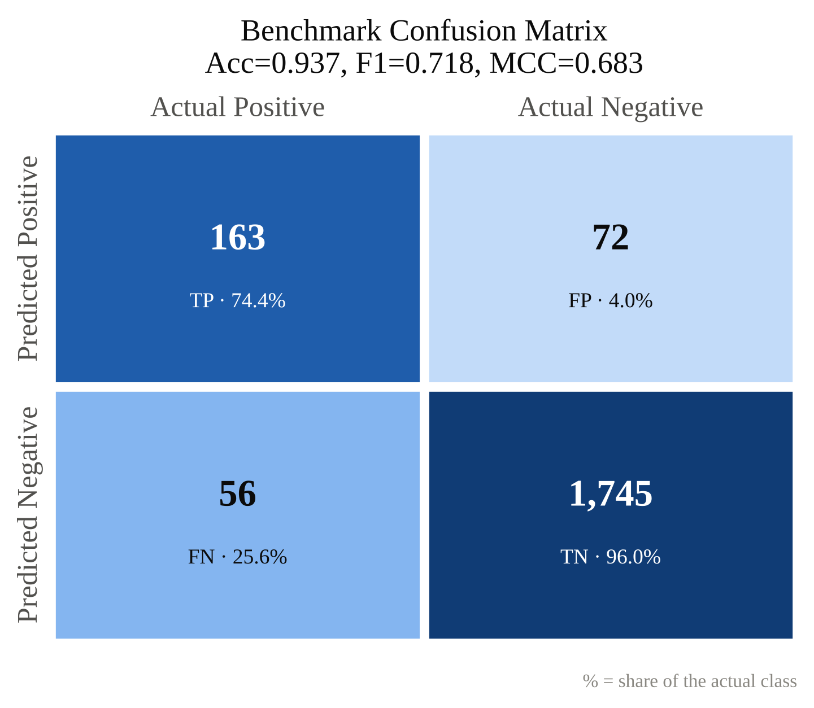

# 04 – von Heijne classifier

`von_heijne_method.py` builds a von Heijne-style position-specific weight matrix (PSWM) from the region around the signal peptide cleavage site. It scores each protein's N-terminus with the matrix and classifies it as a signal peptide when the best score passes a threshold.

```
python 04_von_heijne/von_heijne_method.py     # paths default to the project layout
```
Options: `--cv-dir`, `--pos-fasta`, `--neg-fasta`, `--output`.

## Method
1. **Data.** The cross-validation and benchmark TSVs from `02_data_preparation/cross_validation/` are joined to their sequences in the FASTA files from `01_data_collection/`. Each sequence is cut to its first 90 residues.
2. **Motifs.** For every positive in the training folds, the 15-residue window around the cleavage site *c* is taken: positions −13 to +2, i.e. `seq[c-13 : c+2]`.
3. **PSWM.** Residues are counted at each of the 15 positions with a pseudocount of 1 and normalised per column. Each frequency is turned into a log-odds score log₂(f / background) against the SwissProt amino acid background frequencies, giving a 20 × 15 matrix.
4. **Scoring.** A 15-residue window slides along the first 90 residues and the protein's score is the highest window score. Residues outside the 20 standard amino acids score 0.
5. **Threshold.** The threshold is set at the point of the precision–recall curve on the validation fold where F1 is highest.
6. **Cross-validation.** 5-fold rotation: test = fold *i*, validation = fold *i+1*, training = the remaining 3 folds.
7. **Benchmark.** The round with the best test MCC (run 3) is rebuilt on its training and validation folds (1, 2, 4, 5). The rebuilt matrix is applied to the benchmark set using that round's threshold.

## The PSWM



*Final PSWM (log₂ odds against the SwissProt background), rebuilt on folds 1, 2, 4 and 5. Positions are relative to the cleavage site, which is marked by the vertical line between −1 and +1. Red = enriched in signal peptides, blue = depleted, grey ≈ background. The colour scale is clipped at ±3; the printed values are exact.*

The matrix reproduces the known structure of a eukaryotic signal peptide:
- **h-region (positions −13 to −6).** Leu has the highest score (+1.6 to +2.1 at −13 to −7), followed by Cys, Phe, Val and Trp. Charged residues (D, E, K, R) and Asn are strongly penalised (mostly −2 to −5.6).
- **c-region and cleavage site.** The highest scores in the matrix belong to Ala at −1 (+2.58) and −3 (+1.79), with Val (+1.70) and Cys (+2.25) also favoured at −3, and Gly (+1.44) and Ser (+0.90) also accepted at −1. This is the (A/V)-X-A rule. Large hydrophobic and aromatic residues are strongly disfavoured at −1 and −3 (Ile −3.84, Val −4.05 at −1; Phe −3.80, Tyr −4.40 at −3).
- **Mature protein (+1, +2).** Pro is favoured at +2 (+1.58), and charged/polar residues are no longer penalised.

## Results
### Cross-validation (test folds)
| Run | Test fold | Val fold | Threshold | Accuracy | Precision | Recall | F1 | MCC |
|---|---|---|---|---|---|---|---|---|
| 1 | 1 | 2 | 9.97 | 0.945 | 0.803 | 0.648 | 0.717 | 0.692 |
| 2 | 2 | 3 | 10.86 | 0.942 | 0.839 | 0.566 | 0.676 | 0.660 |
| 3 | 3 | 4 | 9.20 | 0.942 | 0.713 | 0.766 | 0.738 | **0.706** |
| 4 | 4 | 5 | 8.96 | 0.932 | 0.659 | 0.771 | 0.711 | 0.675 |
| 5 | 5 | 1 | 9.41 | 0.932 | 0.684 | 0.680 | 0.682 | 0.644 |
| **Mean ± SD** | | | 9.68 ± 0.76 | 0.938 ± 0.006 | 0.739 ± 0.078 | 0.686 ± 0.086 | 0.705 ± 0.026 | 0.675 ± 0.025 |

Combined confusion matrix over the 5 test folds: TP = 601, FP = 226, FN = 275, TN = 7039.


*Precision–recall curves on the validation folds. The dot on each curve marks the threshold with the best validation F1, which is then applied to that round's test fold. The curves are close together, but the best-F1 points fall at different places along them (recall 0.62–0.75), so the threshold changes from round to round.*



*Left and centre: ROC and precision–recall curves pooled over the 5 test folds (ROC AUC = 0.96, average precision = 0.78). The high AUC but modest AP reflects the class imbalance (about 1 positive per 8 negatives): the PSWM ranks most positives above most negatives, but at any useful recall a sizeable share of the top-scoring proteins are negatives. Right: PSWM averaged over the 5 rounds, almost identical to the final matrix.*



*Confusion matrix summed over the 5 test folds.*

### Benchmark (219 positives / 1817 negatives, threshold 9.20)
| TP | FP | FN | TN | Accuracy | Precision | Recall | Specificity | F1 | MCC |
|---|---|---|---|---|---|---|---|---|---|
| 163 | 72 | 56 | 1745 | 0.937 | 0.694 | 0.744 | 0.960 | 0.718 | 0.683 |



*Confusion matrix on the benchmark set (final PSWM, threshold 9.20).*

The false-positive rate is 19.1 % for negatives with an N-terminal transmembrane helix (39 / 204) and 2.0 % for all other negatives (33 / 1613). More than half of the 72 false positives are transmembrane proteins. A hydrophobic helix near the N-terminus followed by small residues looks like a signal peptide's h-region and cleavage site to the PSWM.

The benchmark MCC (0.683) is in line with the cross-validation mean (0.675 ± 0.025), so the model generalises without signs of overfitting. The threshold, however, varies between rounds (8.96–10.86), which explains the large spread in precision and recall: a higher threshold trades recall for precision.

### Limitations
- The benchmark model is the round with the best **test** MCC, so the benchmark estimate is slightly optimistic. Training on all 5 folds with the mean CV threshold (9.68) would avoid using the test folds for model selection.
- The threshold (9.20) was tuned for a matrix built on 3 folds but is applied to the matrix rebuilt on 4 folds, whose scores are on a slightly different scale.
- The scan covers all of the first 90 residues, so the PSWM can fire on a motif-like window far from where a cleavage site could be (see `06_comparison`). Restricting the window to a plausible cleavage range would likely reduce false positives.
- One benchmark positive has a cleavage-site window that is mostly `X` (`XLXLLXMXXMXXXDS`). `X` scores 0, so this protein cannot be detected.

## Outputs (`model_results/`)
| File | Content |
|---|---|
| `cv_runs.tsv`, `cv_summary.tsv` | metrics for each run, and mean / SD / SE |
| `pswm_final.tsv`, `pswm_final.png` | the final PSWM, rebuilt on folds 1, 2, 4 and 5 |
| `combined_model_metrics.png` | pooled ROC curve, pooled precision–recall curve and average PSWM |
| `pr_curves_all_rounds.png` | validation precision–recall curves with the chosen thresholds |
| `confusion_matrix_combined.png`, `confusion_matrix_benchmark.png` | combined CV and benchmark confusion matrices |
| `benchmark_true_positives.tsv`, `benchmark_false_negatives.tsv` | benchmark positives split by outcome, with their scores |
| `motifs_true_positives.tsv`, `motifs_false_negatives.tsv` | cleavage-site 15-mers of those proteins, e.g. for sequence logos |
| `rounds/` | PSWM heatmap, validation precision–recall curve and test confusion matrix for each round |
