# 05 – SVM classifier

`svm_model.py` trains RBF-kernel SVMs that separate signal-peptide proteins from negatives, using features computed from the N-terminal region. Model selection follows the course protocol: **nested cross-validation** on the 5 predefined subsets.

```
python 05_svm/svm_model.py      # paths default to the project layout; takes about 15–20 minutes
```
The console output of the run that produced `model_results/` is saved in `run_log.txt`.

## Features (39)
| Group | Region | Features |
|---|---|---|
| Amino acid composition | first *n* residues, *n* = median SP length of the current training set | 20 frequencies |
| Kyte–Doolittle hydrophobicity (window 7) | 1–40 | mean, max, position of max |
| Aliphatic index (window 7) | 1–40 | mean, max, position of max |
| TM-helix propensity (window 7, triangular) | 1–80 | mean, max, position of max |
| α-helix / β-sheet propensity, Chou–Fasman (window 9, triangular) | 1–40 | mean, max, position of max (each) |
| Net charge (window 3) | 1–20 | max, position, min, position |

Scales come from [ProtScale](https://web.expasy.org/protscale/). *n* is recomputed from the positives of every training set the model is fitted on; it came out as **22** every time. The other regions are fixed and long enough to contain the whole signal peptide: 98 % of the training SPs are at most 40 residues long (91 % at most 30).

## Procedure
Every step that learns something from data – *n*, the Random Forest ranking, the scaler and the SVM – is fitted on training data only. The test subset is used once, after every choice has been made.

1. **Outer loop (evaluation).** Each of the 5 subsets is the test set once; the other 4 are the training set.
2. **Inner loop (model selection).** A 4-fold CV on those 4 training subsets: in turn, 3 subsets train and 1 validates. In each inner fold:
   - *n* is computed and the features are extracted;
   - a Random Forest (500 trees, fixed `random_state`, not tuned) ranks the features by Gini importance;
   - an SVM is trained for every combination of **k** (number of top-ranked features), **C** and **γ**.
3. **Grid.** k ∈ {5, 10, 15, 20, 25, 30, 35, 39} (the course grid {D/4, D/2, D} = {10, 20, 39} plus intermediate values, to draw the MCC-vs-k curve), C ∈ {1, 4, 16}, γ ∈ {0.5/k, 1/k, 2/k} (1/k is `gamma='scale'` on k standardised features). When the best C or γ lies on the edge of its grid, the grid is extended (C ×4 or ÷4, γ ×2 or ÷2) and the new combinations are evaluated, up to 3 times.
4. **Choice.** Each combination is scored by its **mean validation MCC over the 4 inner folds**, and the combination with the highest mean MCC is kept, as in Practical session IV ("select (k\*, C\*, γ\*) with the highest mean MCC on the 4 inner validation folds").
5. **Refit and test.** *n*, the ranking, the scaler and the SVM are refitted on all 4 training subsets with the chosen values and scored once on the test subset.
6. **Final model and benchmark** (slides *Training the two final predictors*). The same search is run as a complete 5-fold CV over all hyperparameters on the whole training set; the best combination is retrained on all of it (the production model) and evaluated once on the benchmark set. Nothing about the benchmark is used for any choice.

Three models are reported in every run, all from the same inner search:
- **Selected features** – the full pipeline (RF top-k → SVM) with the choice above; this is the model of the project.
- **One-SE rule** – a variant suggested in the feature-selection slides ("prefer the smallest k whose score is within one standard error of the best"): the smallest k whose best mean MCC is at least *best − 1 SE* (SE of the 4 validation MCCs of the best combination), with the best C and γ for that k.
- **All features** – baseline with k fixed at 39; only C and γ are chosen.

## Results
### Nested cross-validation (outer test folds)
| Run | Test subset | Selected: k (one-SE k), C, γ | Test MCC | All features: C, γ | Test MCC | One-SE rule: test MCC |
|---|---|---|---|---|---|---|
| 1 | 1 | 39 (20), 4, 0.5/k | 0.874 | 4, 0.5/k | 0.874 | 0.850 |
| 2 | 2 | 39 (30), 4, 0.25/k | 0.809 | 4, 0.25/k | 0.809 | 0.801 |
| 3 | 3 | 35 (25), 4, 1/k | 0.887 | 4, 1/k | 0.885 | 0.877 |
| 4 | 4 | 35 (15), 4, 1/k | 0.892 | 1, 1/k | 0.894 | 0.878 |
| 5 | 5 | 35 (25), 4, 0.5/k | 0.868 | 4, 0.5/k | 0.871 | 0.855 |

Mean ± standard error over the 5 outer test folds:

| Model | MCC | Precision | Recall | Accuracy | F1 |
|---|---|---|---|---|---|
| **SVM, selected features** (RF top-k) | **0.866 ± 0.015** | 0.886 ± 0.007 | 0.875 ± 0.021 | 0.974 ± 0.003 | 0.880 ± 0.013 |
| SVM, all 39 features (baseline) | 0.867 ± 0.015 | 0.890 ± 0.009 | 0.873 ± 0.020 | 0.975 ± 0.003 | 0.881 ± 0.014 |
| SVM, one-SE rule (variant) | 0.852 ± 0.014 | 0.886 ± 0.009 | 0.850 ± 0.018 | 0.972 ± 0.002 | 0.867 ± 0.013 |
| *von Heijne (for comparison)* | *0.664 ± 0.016* | *0.695 ± 0.016* | *0.708 ± 0.028* | *0.934 ± 0.003* | *0.699 ± 0.015* |

The chosen C and γ vary a little between runs (C = 4 or 1, γ from 0.25/k to 1/k), but the test MCC moves much more with the test subset than with the hyper-parameters: subset 2 is the hardest for every model (0.80–0.81), the others give 0.85–0.89.

<p>


</p>

*Confusion matrices summed over the 5 outer test folds: selected features (left) and all features (right), in the layout of the course slides (rows = observed class, columns = predicted class). Each cell is shaded by its share of the observed class (its row), and that percentage is printed under the count, so the small positive class is as easy to read as the negatives.*

### Choosing k


*Mean inner-validation MCC as the top-k features are added (best C and γ for each k), one curve per outer run. Filled dot = the k chosen (best mean MCC); hollow dot = the k the one-SE rule would keep.*

The curves rise steeply up to k = 10–15 and keep climbing slowly to a peak at k = 35 (k = 39 in runs 1 and 2). Unlike the worked example in the slides, they do not fall after the peak: the extra features are weak but not pure noise. The inner CV therefore keeps 35 or all 39 features. In the final 5-fold search on the whole training set the best combination is k = 39 (CV MCC 0.875), practically tied with k = 35 (0.875), so **the final model uses all 39 features**.

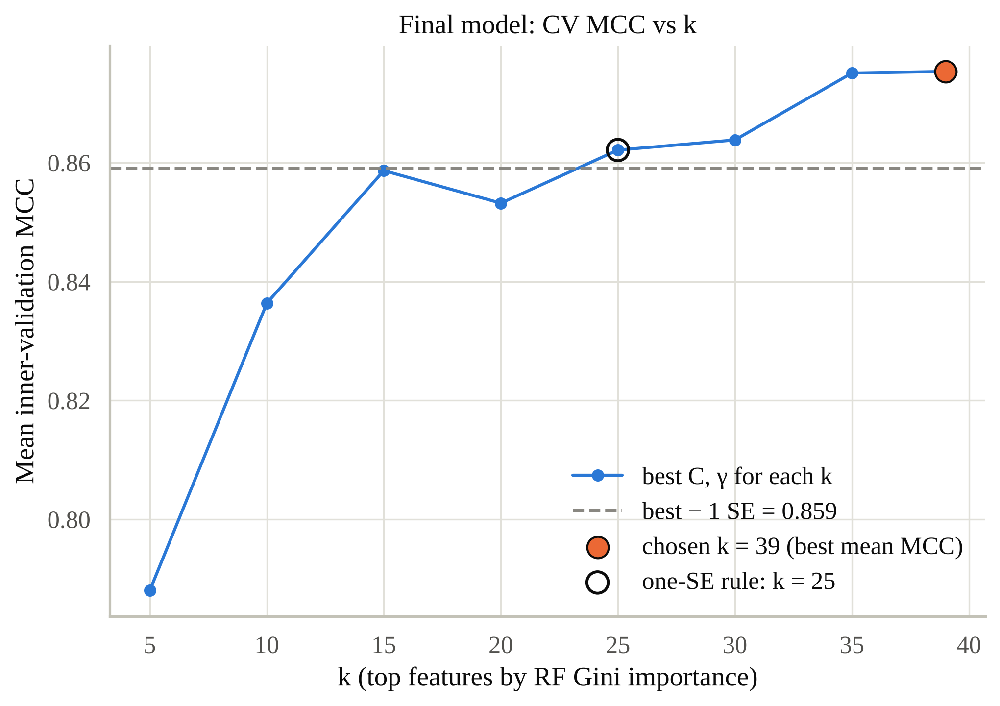

*Final 5-fold search on the whole training set: mean validation MCC for each k (best C and γ for that k). Filled dot = chosen k (39, best mean MCC); hollow dot = the k the one-SE rule would keep (25); dashed line = best − 1 SE.*

**Feature selection gives no measurable difference** here: the nested-CV MCC is 0.866 ± 0.015 with selection and 0.867 ± 0.015 with all 39 features, far below one standard deviation of the fold scores (0.033), which the slides say to report as "no measurable difference".

The one-SE variant keeps much smaller models (k = 15–30), because the standard error of the best inner MCC is large (0.008–0.021). That costs accuracy: its test MCC is lower than the selected-features model in every outer run (by 0.008 to 0.024, mean 0.014), and on the benchmark its MCC is 0.834 (k = 25) against 0.866. With this data set, dropping the weaker features does not pay. The main model follows the course rule in any case; the variant is reported for information, not used to choose anything.

### C × γ at the chosen k

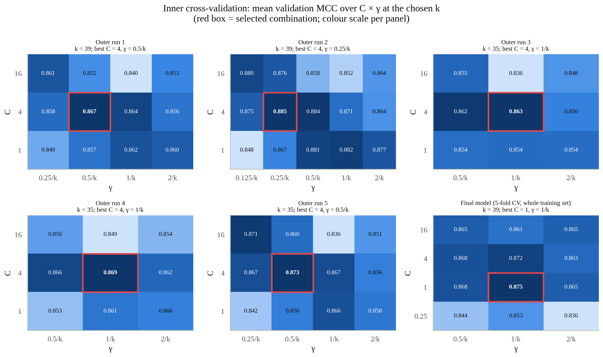

*Mean inner-validation MCC for every (C, γ) tried at the chosen k, in each outer run and in the final 5-fold search. Red box = the selected combination; "not run" = combination added only in another panel by the grid extension. Colour scale per panel. Drawn by `06_comparison/extra_figures.py`; summary in `inner_mcc_heatmap.tsv`.*

No selected combination lies on the edge of the grid that was finally searched: where the initial grid {1, 4, 16} × {0.5, 1, 2}/k put the best value on an edge, it was extended (C = 0.25 in the final search, γ = 0.25/k and 0.125/k in run 2). The surface is flat: within each panel the MCC varies by only 0.02–0.04, and the neighbours of the best cell are usually within one SE (0.008–0.021), so the exact C and γ carry little meaning.

### Feature importance and selection frequency


*Random Forest Gini importance (mean ± SD over the 5 outer-run rankings, each fitted on that run's 4 training subsets) for the top 25 features. The label gives the number of outer runs in which the feature was among the selected top-k. Following the slides, selection is reported as a frequency across folds, not as one run's list.*

The ranking is very stable across runs. The first four features and ranks 7–9 have the same rank in every run, tm_max and Leu content only swap 5th and 6th place, and no feature moves by more than six places (the largest shifts are for the composition of Ile, Cys and Pro, all ranked 22nd or lower). 35 of the 39 features are selected in all 5 runs; the composition of Gln, Met, Tyr and His (the four lowest-ranked features) only in the two runs that keep all 39.

The ranking is dominated by the hydrophobic core of the signal peptide. The six most important features – maximum hydrophobicity, maximum aliphatic index, mean hydrophobicity, the position of the TM-propensity maximum, the Leu content and the maximum TM propensity – account for almost 60 % of the total importance, and the maximum hydrophobicity alone for about a fifth. Leu content, computed over the first 22 residues (roughly the signal peptide itself), is the only composition feature in the top 10.


*Random Forest Gini importance of the top 20 features, ranked on the whole training set (the ranking used by the final model).*

### Benchmark (221 positives / 1,817 negatives)
Final model: n = 22, all **39** features (the best k of the 5-fold CV), C = 1, γ = 1/k (0.026), chosen by 5-fold CV on the whole training set (CV MCC 0.875). Several (k, C, γ) combinations score within 0.01 MCC of each other (`inner_scores_final.tsv`), less than one SE (0.016), so the exact choice carries little meaning.

| Model | TP | FP | FN | TN | MCC | Precision | Recall | Specificity | F1 |
|---|---|---|---|---|---|---|---|---|---|
| **SVM, final model** (k = 39) | 191 | 22 | 30 | 1795 | **0.866** | 0.897 | 0.864 | 0.988 | 0.880 |
| SVM, one-SE rule (k = 25, C = 1, γ = 2/k) | 183 | 26 | 38 | 1791 | 0.834 | 0.876 | 0.828 | 0.986 | 0.851 |

Because the selected-features model kept all 39 features, it is identical to the all-features baseline on the benchmark.

<p>

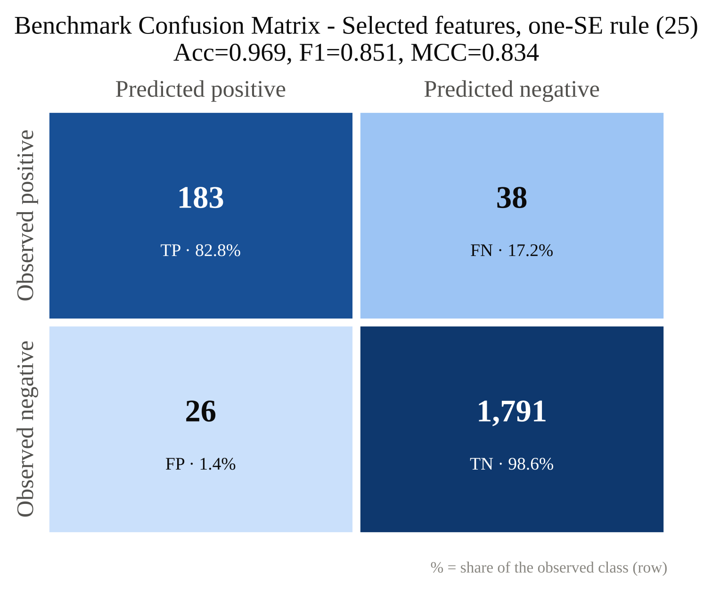
</p>

*Benchmark confusion matrices of the final model (left) and the one-SE variant (right, k = 25), in the same layout. The all-features baseline (`confusion_matrix_benchmark_all.png`) is identical to the final model, since the final model keeps all 39 features:*


The benchmark MCC (0.866) matches the nested-CV estimate (0.866 ± 0.015), so the model generalises well. Compared with von Heijne on the same benchmark (MCC 0.672), the SVM has about 4× fewer false positives (22 vs 95) and fewer false negatives (30 vs 48); see `06_comparison`.

False-positive rate on the benchmark negatives: **7.4 %** for proteins with an N-terminal transmembrane helix (14 / 188) and **0.5 %** for the rest (8 / 1,629). 14 of the 22 false positives have an N-terminal TM helix, which the hydrophobicity features can mistake for an h-region. The error analysis of the false negatives (training positives vs benchmark TP vs FN for every feature) is in `06_comparison`.

> **Revision notes.**
> - k is now chosen as in Practical session IV and the slides on the final models: the combination with the best mean validation MCC. The previous version used the one-SE rule for k; it is still computed and reported as a variant (see *Choosing k*).
> - All results were recomputed on the current data split (see `02_data_preparation`). The numbers of earlier versions (benchmark of 220 positives) are not comparable, because the train/benchmark partition changed.
> - Confusion matrices now use the slide layout (rows = observed class).

Figures use the same colour scheme as `04_von_heijne` (see its README, *Figure style*).

### Per-round figures

<details>
<summary>MCC-vs-k curve, feature ranking and test-fold confusion matrices of each outer run (click to expand)</summary>

**Inner-CV MCC vs k** (filled dot = chosen k, hollow dot = one-SE k)

<p>
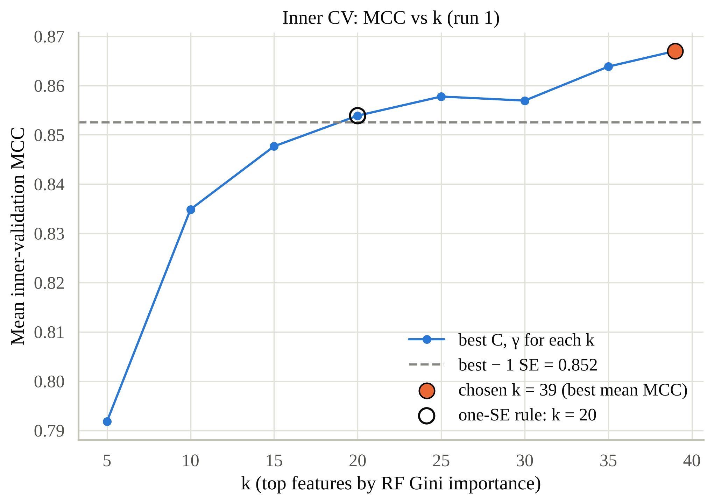
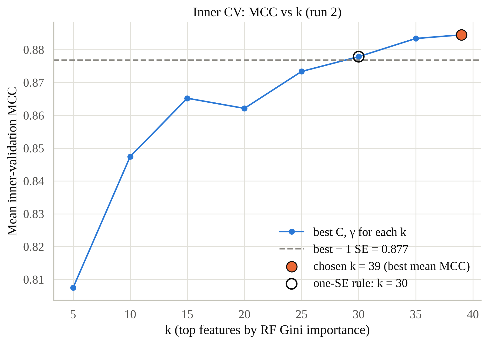
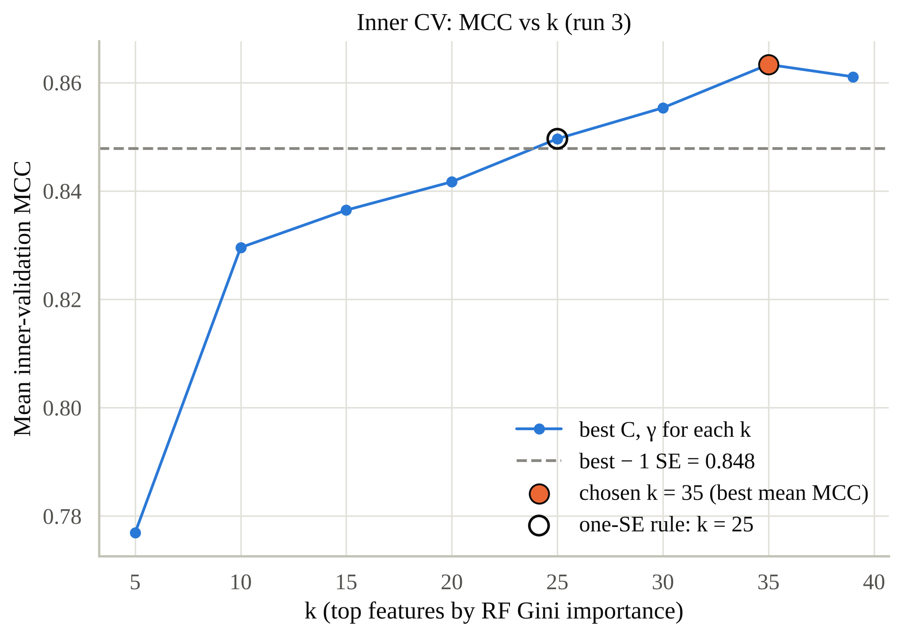
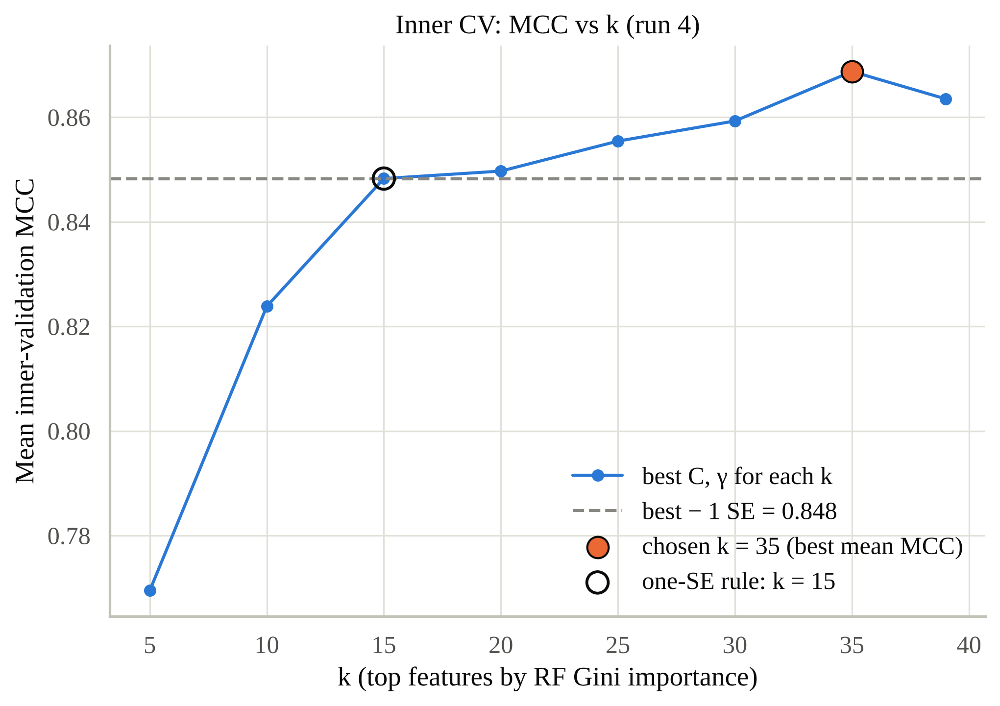
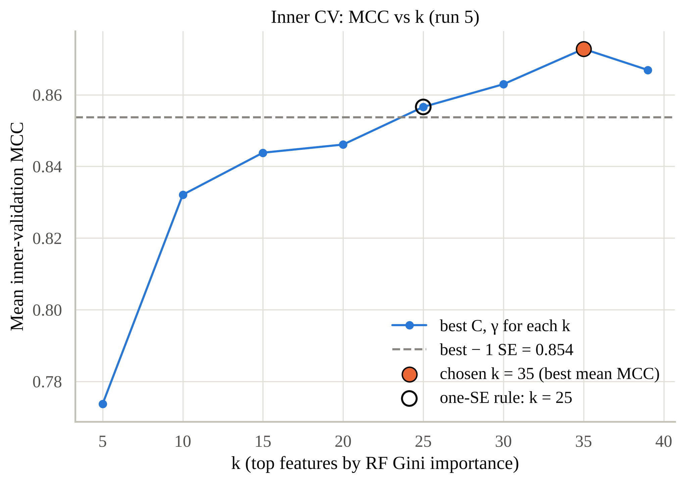
</p>

**Random Forest Gini importance, top 20** (ranked on that run's 4 training subsets)

<p>
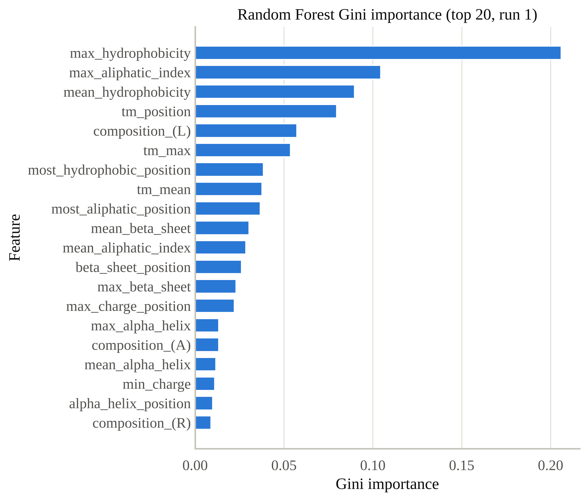
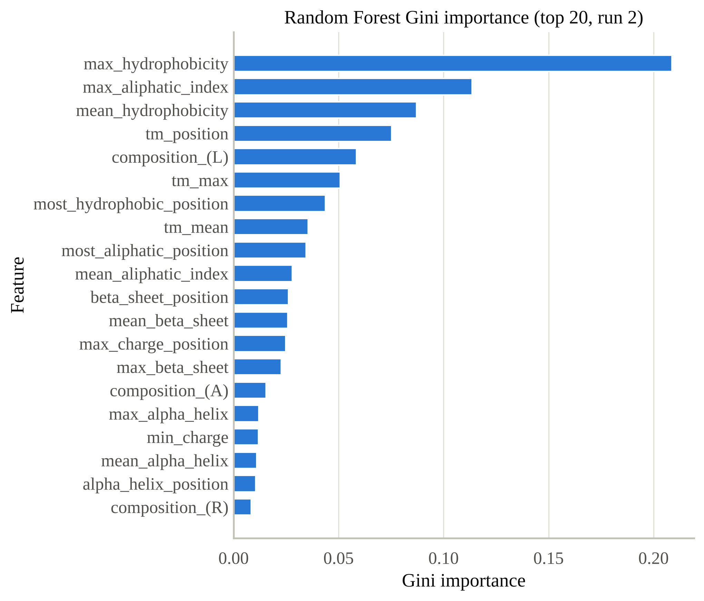

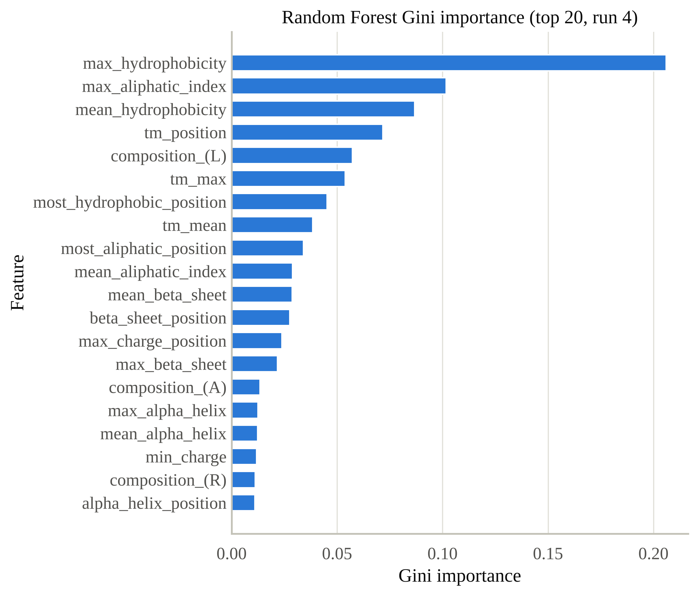

</p>

**Test-fold confusion matrices, selected features** (the model of the project)

<p>

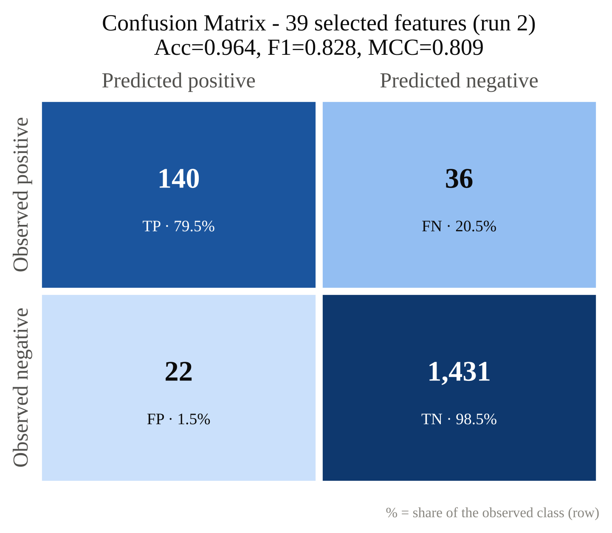
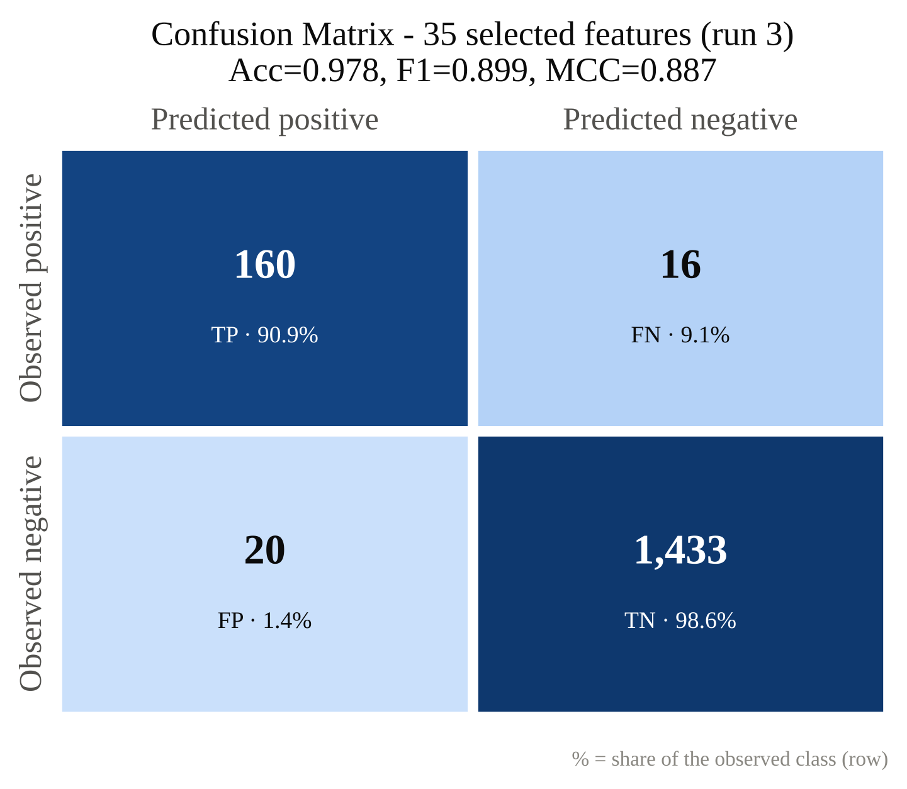


</p>

**Test-fold confusion matrices, all 39 features** (baseline)

<p>
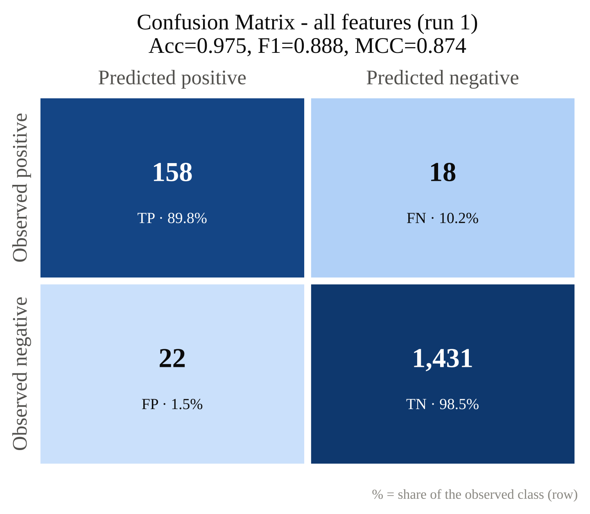
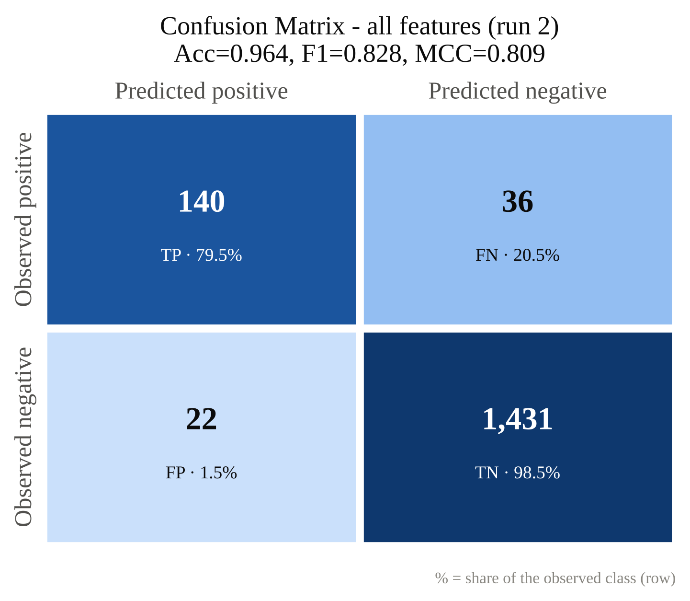


</p>

</details>

## Outputs (`model_results/`)
- `cv_runs.tsv`, `cv_summary.tsv`: per-run metrics and chosen (n, k, peak k, C, γ), and mean / SD / SE for the three models (selected features, one-SE rule, all features)
- `selected_features.tsv`: for each run and for the final model, *n*, the chosen k, its mean validation MCC and SE, the k the one-SE rule would keep, and the selected features
- `feature_selection_frequency.tsv`, `feature_selection_frequency.png`: for each feature, the number of outer runs that selected it, whether the final model uses it, and its mean / SD Gini importance and mean / min / max rank over the 5 runs
- `inner_scores_final.tsv`, `rounds/inner_scores_round{1-5}.tsv`: every (k, C, γ) tried, with its mean and per-fold validation MCC and SE
- `inner_mcc_heatmap.png`, `inner_mcc_heatmap.tsv`: mean inner-validation MCC over C × γ at the chosen k for each outer run and the final model, with the best combination, the MCC range of the grid and whether the best value lies on a grid edge (drawn by `06_comparison/extra_figures.py`)
- `benchmark_metrics.tsv` (final model, all-features baseline and one-SE variant, incl. FPR with / without an N-terminal TM helix), `benchmark_predictions.tsv` (decision values and calls), `benchmark_{true_positives,false_negatives,false_positives}.tsv` (final model)
- `confusion_matrix_combined_{selected,all}.png`, `confusion_matrix_benchmark_{selected,all}.png`
- `mcc_vs_k_all_rounds.png`, `mcc_vs_k_final.png`, `top_features_final.png`, `features_gini_final.tsv`
- `svm_{selected,all}_final.pkl.gz`: the final model and the all-features baseline (identical here, since the final model keeps all 39 features). Each file is a dictionary with the scikit-learn pipeline (`model`), the composition length (`n`), the selected `features`, `k`, `C`, `gamma` and the RF `ranking`; `svm_model.bundle_features()` builds the matching feature matrix.
- `training_features.tsv`: the feature matrix of the training set (composition over n = 22)
- `rounds/`: Gini rankings, top-20 feature plots, MCC-vs-k curves, confusion matrices and models for each outer run
