# 06 – von Heijne vs SVM: benchmark comparison and error analysis

`compare_models.py` runs the two final models on the same benchmark set, compares them and analyses their errors as asked in the course slides (*Training final models and analysis of benchmarking results*). Nothing is retrained:

- **von Heijne:** `04_von_heijne/model_results/pswm_final.tsv`, the PSWM rebuilt on all 5 training folds, with the threshold fixed on validation fold 5 (8.63, read from `final_model.tsv`)
- **SVM:** the final model `05_svm/model_results/svm_selected_final.pkl.gz`, tuned by 5-fold CV over all hyperparameters on the whole training set and retrained on all of it: all 39 features (the best k of the CV), C = 1, γ = 1/k, composition over the first 22 residues. Since it keeps all 39 features, it is identical to the all-features baseline, which is therefore not shown separately.

The script uses the data loader and feature extraction of the two model scripts and the WebLogo code of `03_data_analysis`, so both models get exactly the same inputs. The confusion matrices it produces match the ones reported in 04 and 05.

```
python 06_comparison/compare_models.py      # about 30 s; the logos need weblogo + Ghostscript (see 03)
python 06_comparison/extra_figures.py       # about 30 s; supplementary figures, see the end of this README
```

**Colours are the same in every figure:** von Heijne = blue, SVM = orange. Outcomes: TP = blue, FN = orange, FP = red, TN = grey; in the false-negative figures, training positives = grey, benchmark TP = blue, benchmark FN = orange.

## 1. Overall performance (benchmark: 221 positives / 1,817 negatives)

| Model | TP | FP | FN | TN | MCC [95% CI] | Precision | Recall | F1 | FPR |
|---|---|---|---|---|---|---|---|---|---|
| von Heijne | 173 | 95 | 48 | 1722 | 0.672 [0.625–0.719] | 0.646 | 0.783 | 0.708 | 5.2 % |
| **SVM** | 191 | 22 | 30 | 1795 | **0.866** [0.828–0.899] | 0.897 | 0.864 | 0.880 | 1.2 % |

The confidence intervals come from a stratified bootstrap with 2,000 resamples.

The SVM is clearly better than von Heijne:
- The 95% CI of the MCC difference (SVM − von Heijne) is **[0.138, 0.246]**.
- On a paired McNemar test, 126 proteins are classified correctly only by the SVM and 35 only by von Heijne (exact p = 2.9 × 10⁻¹³).
- The SVM has about 4× fewer false positives (95 → 22) and fewer false negatives (48 → 30).

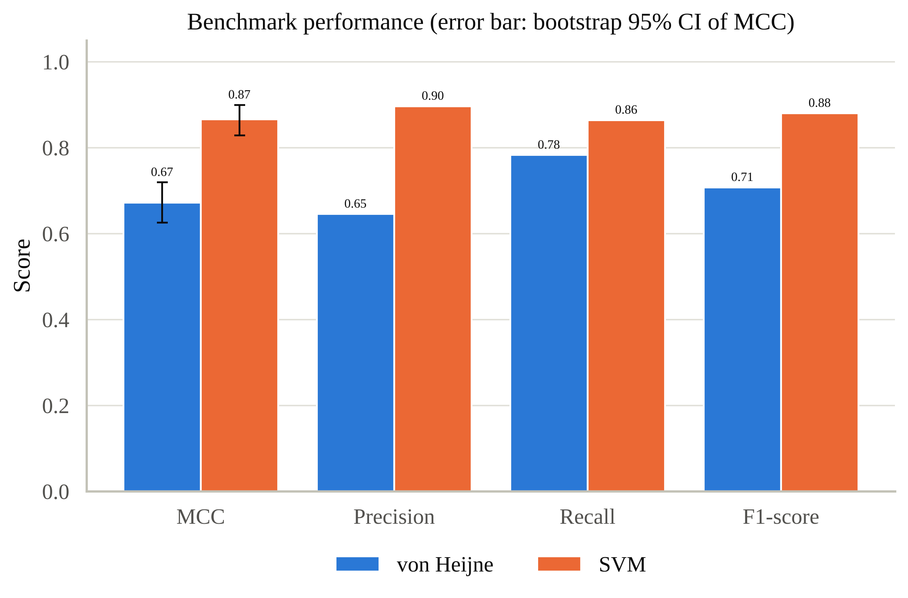

Cross-validation tells the same story (mean ± SE over the 5 test folds; dots = individual folds):

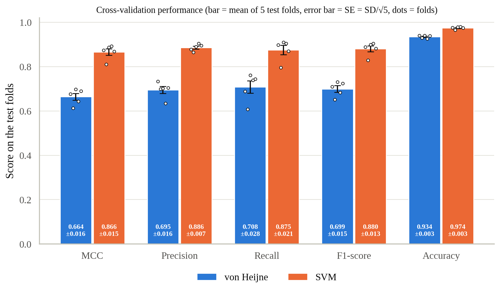

## 2. The two models make different errors

| Error | Both models | von Heijne only | SVM only |
|---|---|---|---|
| FP | 6 | 89 | 16 |
| FN | 11 | 37 | 19 |

Most von Heijne errors are fixed by the SVM: 89 of 95 false positives and 37 of 48 false negatives. Only 6 false positives and 11 false negatives are hard for both models. In the score scatter below, the two scores are correlated, but many proteins above the von Heijne threshold have a negative SVM decision value, especially negatives with an N-terminal transmembrane (TM) helix (black circles). Positives are green triangles and negatives grey dots; the dashed lines are the von Heijne threshold (blue, vertical) and the SVM decision boundary (orange, horizontal).

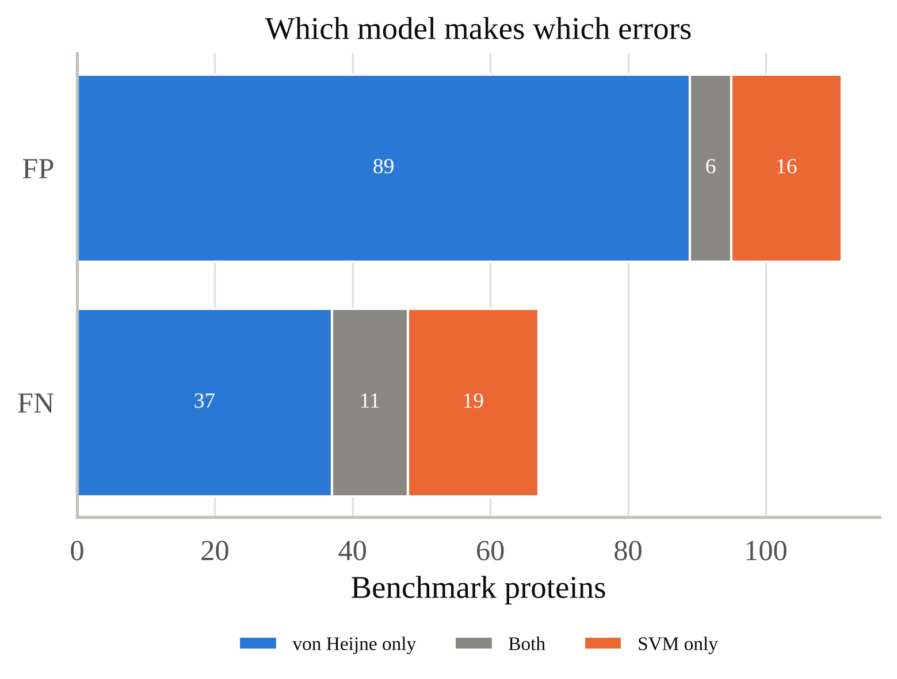
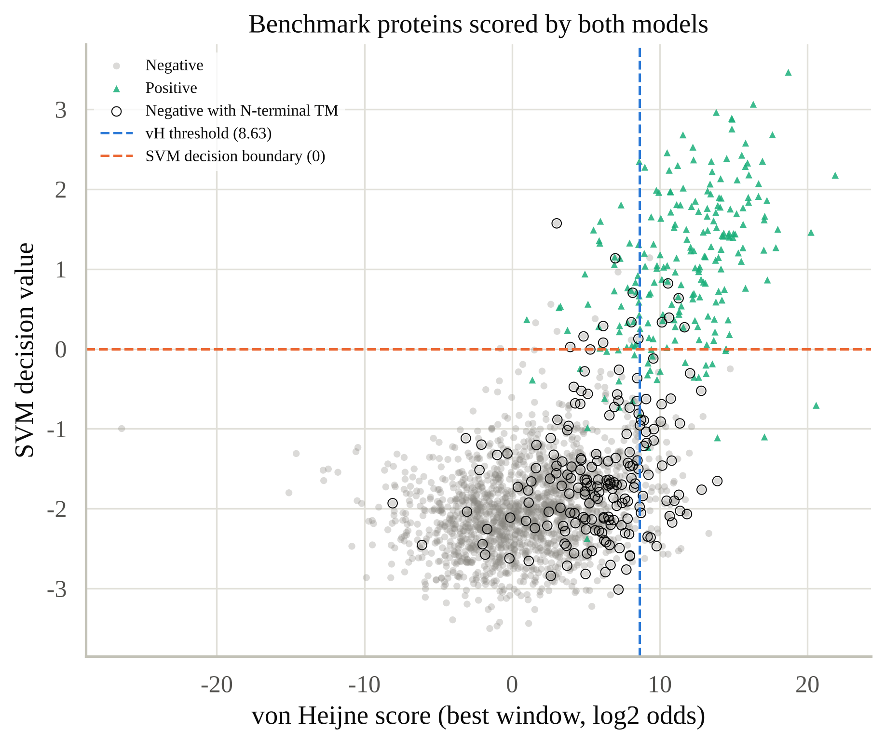

## 3. False positives: transmembrane helices

As the slides ask, the false positives were isolated and checked for a TM helix starting within the first 90 residues (the `N-term TM` flag from UniProtKB, `01_data_collection`).

| | von Heijne | SVM |
|---|---|---|
| **Share of FPs with an N-terminal TM helix** | **41 % (39 / 95)** | **64 % (14 / 22)** |
| FPR, negatives with an N-terminal TM helix (n = 188) | 20.7 % | 7.4 % |
| FPR, other negatives (n = 1,629) | 3.4 % | 0.5 % |

TM proteins are only 10 % of the benchmark negatives, but 41 % and 64 % of the false positives: an N-terminal TM helix is the main confounder for both methods. The SVM lowers the false-positive rate in both groups, but removes the non-TM false positives faster (56 → 8), so TM proteins make up a larger share of its remaining errors.

The two models' false positives look different (positions are residue numbers from the N-terminus; Kyte–Doolittle, window 7):
- **von Heijne FPs** are mostly not signal-peptide-like. Their median maximum hydrophobicity is 2.1 (true positives 3.1, true negatives 1.4), and their most TM-like segment is centred at a median residue 41, like the true negatives (42). The PSWM matches a motif-like 15-mer somewhere in the first 90 residues, because nothing in it requires a hydrophobic core at the N-terminus.
- **SVM FPs** look like real signal peptides. Their median maximum hydrophobicity (3.1) and maximum TM propensity (0.75) are as high as in the true positives (3.2 and 0.71), and their most TM-like segment is near the N-terminus (median residue 14 vs 11). These are hydrophobic N-terminal segments – signal anchors or TM helices – that the features alone cannot tell apart from an h-region.

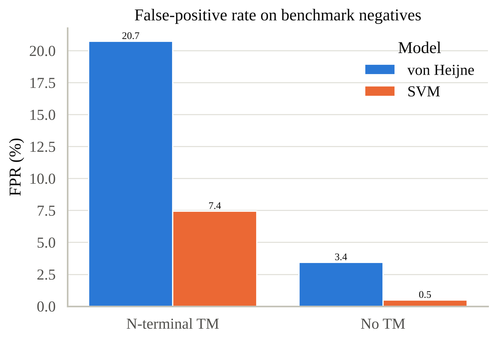
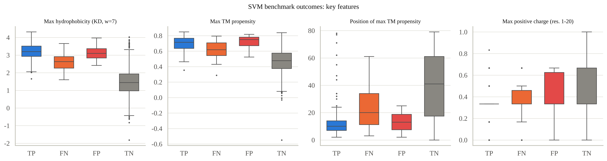

Six individual false positives make the difference concrete (top: the three highest-scoring SVM false positives, two with an N-terminal TM helix; bottom: the three highest-scoring von Heijne false positives that the SVM rejects):

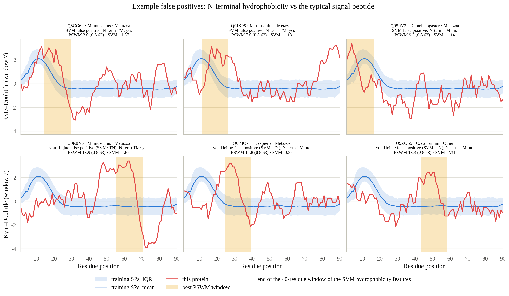

*Kyte–Doolittle profile (window 7, as in the SVM features) of each protein (red) against the training signal peptides (blue: mean and interquartile range). Yellow = the 15-residue window with the best PSWM score. Sequences and numbers in `fp_hydrophobicity_examples.tsv`.*

- The **SVM false positives** have a hydrophobic segment right where an h-region would be (peak around residues 5–20), so on hydrophobicity alone they are indistinguishable from a signal peptide.
- The **von Heijne false positives** mostly do not: in two of the three the best PSWM window lies at residues 44–70, far beyond any plausible cleavage site, on a hydrophobic stretch that is not N-terminal. The SVM, which looks at where the hydrophobic peak lies, rejects them.

## 4. False negatives

### von Heijne: the cleavage-site context

The slides' hypothesis is that the false negatives have a cleavage-site context different from the expected one. The figure compares the logo of the [−13, +2] window of the 48 false negatives with the expected logo (all 880 training positives, the data the PSWM is built from) and with the 173 true positives.

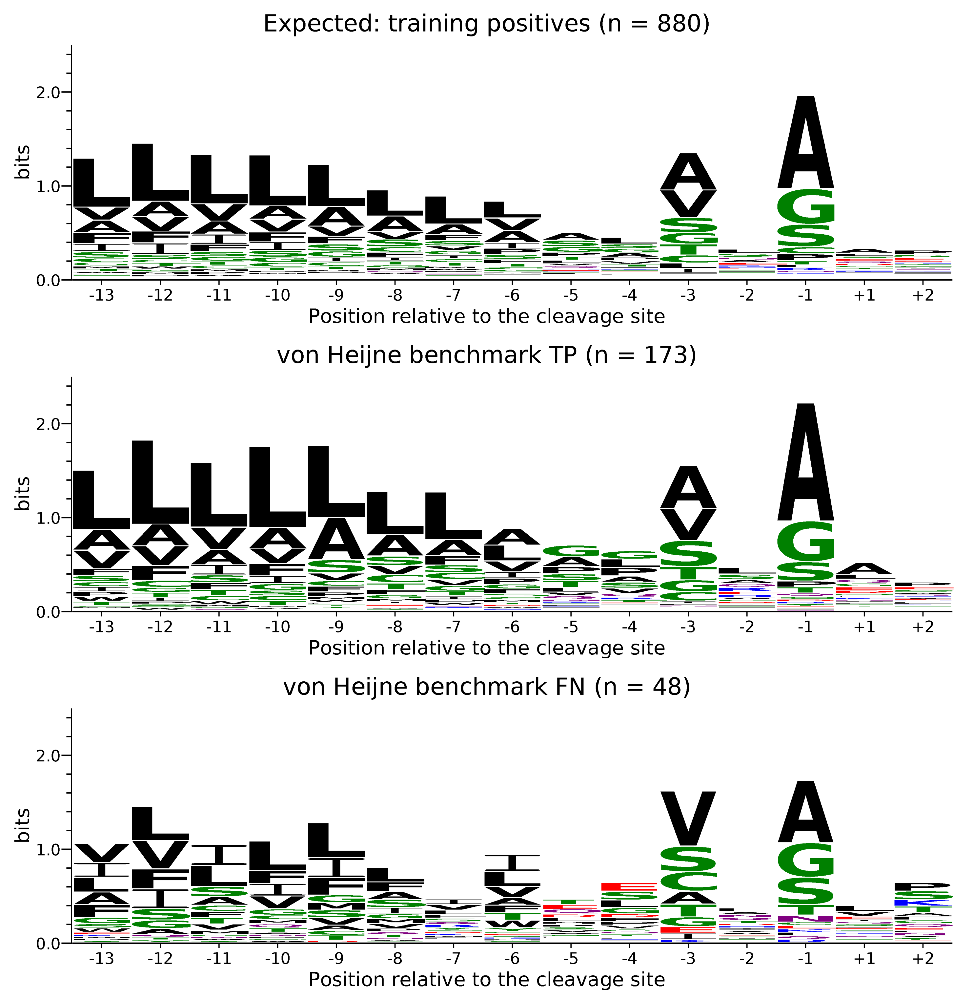

*WebLogo 3 logos on the same 0–2.5-bit axis. With only 48 sequences the FN logo is noisier, so the comparison is about which residues dominate each position rather than exact stack heights.*

| [−13, +2] window | Expected (training positives) | von Heijne TP | von Heijne FN |
|---|---|---|---|
| n | 880 | 173 | 48 |
| Ala at −1 | 51 % | 57 % | **38 %** |
| A-x-A (Ala at −3 and −1) | 17 % | 20 % | **6 %** |
| Small residue at −1 (A, G, S, C, T) | 88 % | 90 % | 83 % |
| Leu in −13…−6 | 35 % | 40 % | **21 %** |
| Median PSWM score of the true cleavage window | – | 12.4 | **6.3** (threshold 8.63) |
| Best-scoring window = true cleavage window | – | 72 % | 50 % |

(`vh_cleavage_site_by_outcome.tsv`)

The hypothesis holds. The false negatives depart from the expected context at the positions the PSWM weights most:
- **Cleavage site.** Ala at −1 is much rarer, and −3 is dominated by Val, Ser and Cys instead of Ala. The canonical A-x-A pair occurs in only 6 % of them. The small-residue rule itself is still mostly respected (83 % at −1), so these are real but non-canonical sites.
- **h-region inside the window.** Leu, the residue with the highest weights at −13…−6, is about half as frequent (21 % vs 35 %). The logo shows Ile, Val and Phe instead, and the composition of the first 22 residues confirms it (Ile 9.6 % vs 4.8 % in the training positives, Phe 7.8 % vs 5.3 %; Ala only 7 % vs 13 %; figure below). These proteins do have a hydrophobic core: their median maximum hydrophobicity (3.2) is the same as in the true positives. It is just made of residues the PSWM scores lower.

As a result, the true cleavage window of a false negative scores a median 6.3, well below the threshold. For half of them, the best window is not even at the true site.

### SVM: training positives vs benchmark TP vs benchmark FN

For each feature, the slides ask to compare the training positives with the benchmark true positives and false negatives. The three groups are compared for the N-terminal composition (first *n* = 22 residues, as in the model), the signal-peptide length and every one of the 39 features the final SVM uses (`svm_fn_features.tsv`, with medians, standardised mean differences and Mann–Whitney tests).

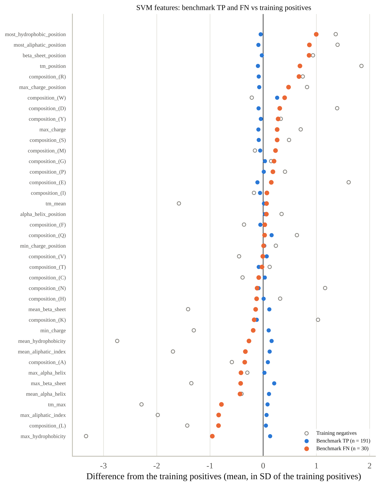

*Mean of each feature in the benchmark TP (blue) and FN (orange), and in the training negatives (grey circles) for reference, as a difference from the training positives in units of their standard deviation. Features are sorted by the FN difference.*

The benchmark true positives sit on the training positives for every feature (all differences within ±0.26 SD), so the model sees what it was trained on. The false negatives differ in a consistent direction, part of the way towards the negatives:
- **A weaker and displaced hydrophobic core.** Lower maximum hydrophobicity (−1.0 SD; median 2.6 vs 3.2 for TP), lower maximum aliphatic index and TM propensity (about −0.8 SD), and the hydrophobic peak lies further downstream: median residue 15 vs 11 for the most hydrophobic window and 21 vs 11 for the TM-propensity peak (+0.7 to +1.0 SD). All p < 0.001 against the training positives.
- **Composition of the first 22 residues.** Less Leu (14 % vs 22 % in the training positives) and Ala (10 % vs 13 %), more Arg (6.1 % vs 3.2 %), Ser and Gly.
- **Longer signal peptides.** The SVM false negatives have longer SPs (median 25 vs 22 aa, mean 27.8 vs 22.9; Mann–Whitney p = 0.007 against the training positives). A longer SP pushes the h-region away from the first ~20 residues on which the composition and charge features are computed, which fits the displaced hydrophobic peak. The von Heijne false negatives, by contrast, have normal SP lengths (median 22, p = 0.85).

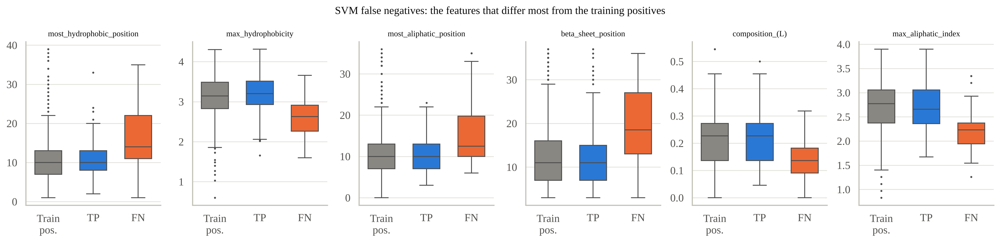
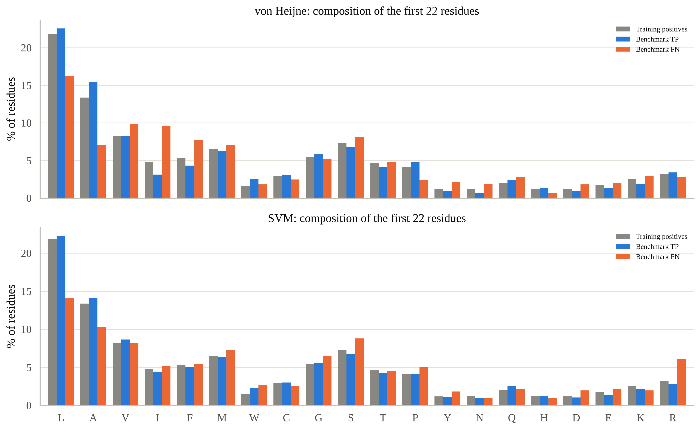
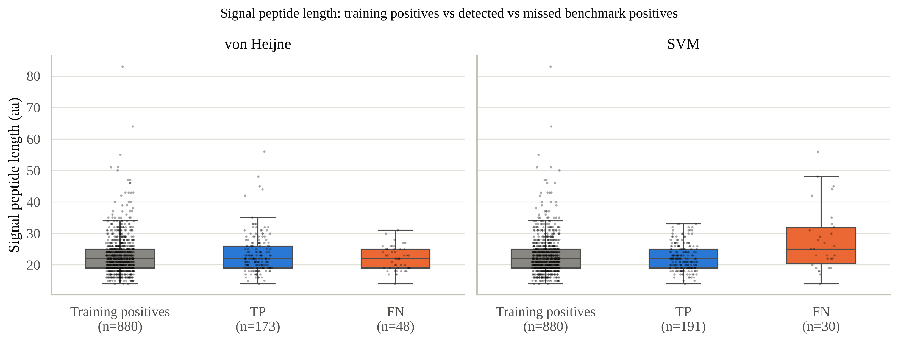

## 5. Errors by kingdom and species

The slides ask whether the errors are equally distributed among taxa. Bar labels give the counts (errors / proteins of that class); many groups are small.

| Kingdom (pos / neg) | FPR vH → SVM | FNR vH → SVM |
|---|---|---|
| Metazoa (170 / 945) | 6.2 % → 1.5 % | 21.2 % → 13.5 % |
| Fungi (19 / 505) | 2.2 % → 0.8 % | 21.1 % → 21.1 % |
| Viridiplantae (25 / 322) | 6.2 % → 0.6 % | 20.0 % → 8.0 % |
| Other (7 / 45) | 11.1 % → 4.4 % | 42.9 % → 14.3 % |

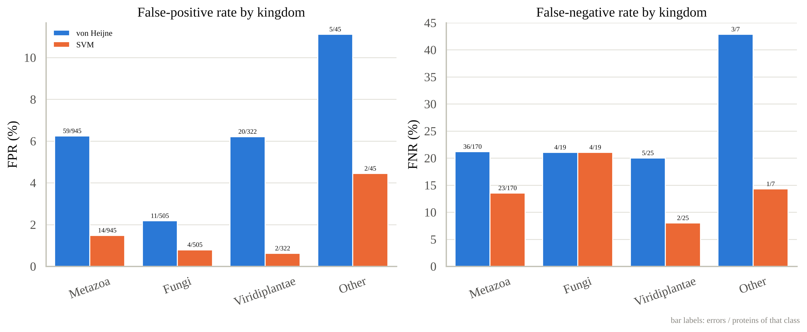
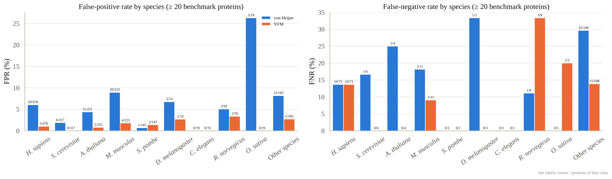

*Species with at least 20 benchmark proteins; the others are pooled as "Other species".*

- **False positives.** The SVM lowers the FPR in every kingdom and in almost every species. For von Heijne the FPR is not uniform: it is lower in Fungi (2.2 %, mostly yeast proteins) than in Metazoa and plants (6.2 %; Fisher p = 10⁻⁴ for Fungi vs the rest). The highest species-level FPRs of von Heijne are in mouse (9.0 %) and in rice (5 of 19, a small group).
- **False negatives.** For von Heijne, the FNR is about 20 % in each of the three main kingdoms. At species level it is twice as high for positives from the many less-studied species pooled as "Other species" (30 %, 32 / 108) as for those from the model organisms (14 %; p = 0.006). The SVM does not show this difference (14 % vs 13 %). The SVM's FNR is lowest in plants (2 / 25) and highest in Fungi (4 / 19), but with so few positives this difference is not significant (p = 0.30). In *Homo sapiens*, which holds a third of the benchmark positives, both models miss the same fraction (10 / 73).

With 7–25 positives outside Metazoa, these per-taxon rates are exploratory. None of them was used to tune either model.

## Conclusion

The two models encode different parts of the signal peptide, and their errors show it:
- **The PSWM** scores the **cleavage-site motif**. It misses signal peptides whose cleavage window departs from the canonical A-x-A context with a Leu-rich h-region, even when the hydrophobic core is there. It has no notion of where the h-region should be, so it fires on motif-like windows anywhere in the first 90 residues and on N-terminal TM helices.
- **The SVM** models the **global N-terminal physicochemistry**: hydrophobicity, TM propensity, charge and composition. That removes most false positives and recovers most of the motif-atypical signal peptides. Its remaining errors are the biologically hard cases: N-terminal TM helices or signal anchors, which look like an h-region, and long signal peptides with a weak or displaced hydrophobic core.

Since their errors barely overlap (6 shared FPs, 11 shared FNs), adding the von Heijne score as an extra SVM feature is a natural next step.

> **Revision notes.**
> - The error analysis now follows the slides on the final models: the share of false positives with an N-terminal TM helix; logos of the von Heijne false negatives against the expected logo; for the SVM, training positives vs benchmark TP vs FN for the composition of the first *n* residues, the SP length and every feature used; errors by species as well as by kingdom.
> - Everything was recomputed with the current data split and the revised final models (von Heijne threshold from the validation fold; SVM with the best mean CV MCC). Earlier numbers (benchmark of 220 positives) are not comparable, because the train/benchmark partition changed.

## Extra figures (`extra_figures.py`)

`extra_figures.py` draws five supplementary figures from the saved outputs of 04 and 05, without retraining anything (about 30 s): `02_data_preparation/data_split_diagram.png`, `04_von_heijne/model_results/score_distribution.png`, `05_svm/model_results/inner_mcc_heatmap.png`, and `cv_metrics_comparison.png` and `fp_hydrophobicity_examples.png` here (each with a matching `.tsv`).

```
python 06_comparison/extra_figures.py      # after compare_models.py
```

## Outputs (`comparison_results/`)

| File | Content |
|---|---|
| `benchmark_metrics.tsv` | metrics and bootstrap MCC CI for both models |
| `mcnemar_test.tsv` | paired test von Heijne vs SVM, with the CI of the MCC difference |
| `benchmark_predictions.tsv` | per protein: both scores, calls and outcomes, plus key features |
| `error_overlap.tsv` | FP / FN shared or unique to each model |
| `fpr_by_tm.tsv` | FPR with / without an N-terminal TM helix, share of FPs that are TM proteins |
| `vh_cleavage_site_by_outcome.tsv` | cleavage-site residues and PSWM scores: training positives, vH TP, vH FN |
| `svm_fn_features.tsv` | every SVM feature: medians, standardised differences and Mann–Whitney tests, training positives vs TP vs FN |
| `sp_length_by_outcome.tsv` | SP length of training positives, TP and FN for each model |
| `rates_by_kingdom.tsv`, `rates_by_species.tsv` | FP / FN counts and rates per taxon |
| `cv_metrics_comparison.tsv` | cross-validation mean ± SE of each metric for both models (behind `cv_metrics_comparison.png`) |
| `fp_hydrophobicity_examples.tsv` | the six example false positives: scores, best PSWM window, maximum hydrophobicity and its position, first 40 residues |
| `*.png` | the figures shown above |
