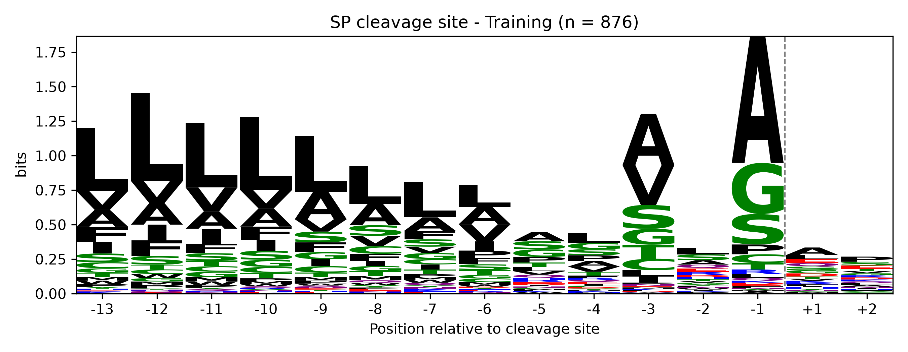
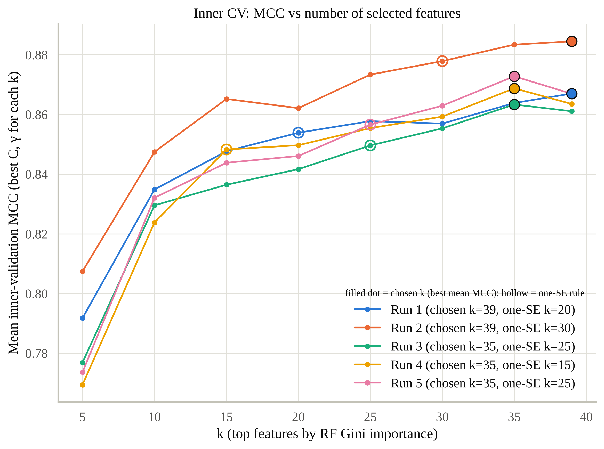
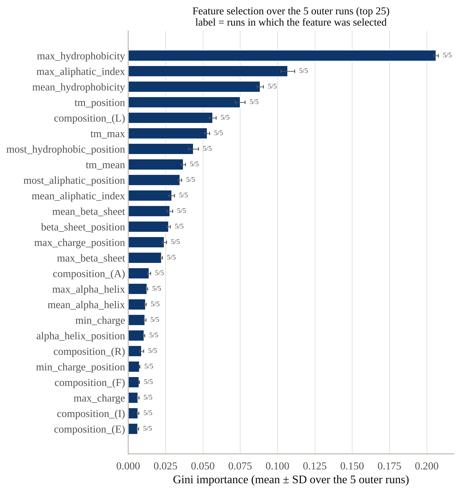

# Group6_LOB2 🧬✂️

> ⚠️ **Disclaimer**
>
> This repository contains student work. It was written by students,
> not by a team of professional researchers locked in a basement with
> unlimited compute :)
>
> Expect experiments, mistakes, questionable code, things that probably
> could have been done better, and the occasional piece of code that
> somehow works. The project is primarily for learning and educational
> purposes.

---

Some proteins are made to leave the cell. To get out, they carry a short tag at their front, called a **signal peptide**: a kind of boarding pass that the cell checks and then cuts off. Rude, but efficient.

**Our goal:** teach a computer to look at a protein sequence and tell whether it has that boarding pass.

This is the **Laboratory of Bioinformatics 2** project (University of Bologna, A.Y. 2026–2027) by **Group 6**.

---

## The project in short

We collect thousands of eukaryotic proteins from **UniProt**, some with a signal peptide and some without. We clean the data, explore it, and then build two predictors:

- **von Heijne method:** a classic approach that learns the typical amino-acid pattern around the signal-peptide cut site.
- **SVM (Support Vector Machine):** a machine-learning model trained on features calculated from each protein.

Finally, we test both methods on proteins they have never seen and compare which one works better.

---

## Project steps

| Step | What we do | Status |
|---|---|---|
| [01 · Data collection](01_data_collection) | Download proteins with and without a signal peptide | ✅ Done |
| [02 · Data preparation](02_data_preparation) | Remove similar sequences, split into training and benchmark sets | ✅ Done |
| [03 · Data analysis](03_data_analysis) | Explore and visualise the data | ✅ Done |
| [04 · von Heijne](04_von_heijne) | Weight-matrix predictor | ✅ Done |
| [05 · SVM](05_svm) | Machine-learning predictor | 🔨 In progress |
| Report | Compare both methods and write it all up | ⏳ To do |

Each folder has its own README with the details.

---

## Results so far

| Method | Cross-validation MCC | Benchmark MCC |
|---|---|---|
| von Heijne | 0.675 ± 0.011 | 0.683 |
| SVM | 0.86 ± 0.01 | 0.87 |

MCC goes from 0 (random guessing) to 1 (perfect). The SVM wins clearly, mostly because it gets fooled far less often by transmembrane proteins, which look a lot like signal peptides. The old method had a point, though: it did all that with a single table of numbers.

---

## Tools

Python (pandas, NumPy, matplotlib, seaborn, scikit-learn), UniProt, MMseqs2, Google Colab, and a worrying amount of coffee ☕

---

## Team

| Name | GitHub |
|---|---|
| *Ahmed Abdelhafize* | [@username]([https://github.com/username](https://github.com/AhmedMohamedEisa)) |
| *Berkay Oktay Demir* | [@username](https://github.com/username) |
| *Mohammad Amin Roshan* | [@username](https://github.com/username) |
| *Mohibuddin Ahmed Umer* | [@username](https://github.com/username) |
| *Rida Niaz* | [@username](https://github.com/username) |

**Course:** Laboratory of Bioinformatics 2, MSc in Bioinformatics, University of Bologna
**Instructor:** Prof. Castrense Savojardo

---

*No proteins were harmed in the making of this project. Several signal peptides were, however, cleaved.* ✂️

# Signal peptide prediction in eukaryotic proteins

**Laboratory of Bioinformatics 2 – Group 6**

Secretory signal peptides are short N-terminal sequences that target a protein to the secretory pathway. They have a typical three-part structure: a positively charged **n-region**, a hydrophobic **h-region** and a polar **c-region** that ends in the cleavage site, usually following the **(A/V)-X-A** rule.

This project builds and compares two classifiers that predict whether a eukaryotic protein has a signal peptide:
1. a **von Heijne position-specific weight matrix (PSWM)** that scores the cleavage-site region;
2. a **support vector machine (SVM)** trained on physicochemical features of the N-terminus.

## Results at a glance
Benchmark: 221 positives / 1,817 negatives, never used for training or model selection.

| Model | CV MCC (mean ± SE) | Benchmark MCC [95 % CI] | Precision | Recall | FPR |
|---|---|---|---|---|---|
| von Heijne (PSWM) | 0.664 ± 0.016 | 0.672 [0.625–0.719] | 0.646 | 0.783 | 5.2 % |
| **SVM** (RF-ranked features, nested CV) | 0.866 ± 0.015 | **0.866** [0.828–0.899] | 0.897 | 0.864 | 1.2 % |

CV values are the mean over the 5 test folds ± the standard error. For the SVM they come from nested cross-validation, with k (the number of Random Forest-ranked features), C and γ chosen in the inner loop by the best mean validation MCC. The inner loop keeps 35 or all 39 features, and the final model keeps all 39: feature selection makes no measurable difference here. Both final models are built as in the course slides on the final models: the von Heijne threshold is fixed on a validation fold of the training set, the SVM hyperparameters by 5-fold CV on the training set, and both are tested once on the benchmark.

- The SVM is significantly better than the PSWM (McNemar p ≈ 3 × 10⁻¹³; MCC difference 95 % CI [0.14, 0.25]). It has about 4× fewer false positives (22 vs 95) and fewer false negatives (30 vs 48).
- The main source of false positives for **both** models is negatives with an **N-terminal transmembrane helix**, which look like an h-region: they are 10 % of the negatives but 41 % of the von Heijne false positives and 64 % of the SVM false positives.
- The two models make mostly different mistakes. Von Heijne misses signal peptides whose cleavage window is non-canonical (Ala at −1 in 38 % of them vs 51 % expected) and whose h-region is made of Ile, Val and Phe rather than Leu. The SVM misses long signal peptides with a weak, displaced hydrophobic core.


## Pipeline
| Step | Folder | What it does | Main output |
|---|---|---|---|
| 1 | [`01_data_collection`](01_data_collection) | Downloads reviewed eukaryotic proteins from UniProt: 2,956 with an experimental signal peptide, 20,974 without | `positive.tsv/.fasta`, `negative.tsv/.fasta` |
| 2 | [`02_data_preparation`](02_data_preparation) | Clusters each set with MMseqs2 (30 % identity, 40 % coverage), keeps one representative per cluster, splits 80/20 into training (5 folds) and benchmark | `cross_validation/{pos,neg}_{train,bench}.tsv` |
| 3 | [`03_data_analysis`](03_data_analysis) | Describes the datasets: SP length, composition, cleavage-site logos (WebLogo), taxonomy, protein length, N-terminal hydrophobicity | `plots/` |
| 4 | [`04_von_heijne`](04_von_heijne) | Builds a 15-position PSWM (−13…+2), 5-fold CV with the threshold picked on a validation fold; final PSWM with the threshold fixed on validation fold 5, retrained on all 5 folds; benchmark | `model_results/` |
| 5 | [`05_svm`](05_svm) | RBF-kernel SVM on 39 N-terminal features (composition over the median SP length), Random Forest feature ranking, nested 5×4-fold CV, final model by 5-fold CV, benchmark | `model_results/` |
| 6 | [`06_comparison`](06_comparison) | Compares both models on the benchmark and analyses their errors: significance tests, TM false positives, logos of the missed cleavage sites, SVM false negatives vs training positives, kingdoms and species; `extra_figures.py` adds supplementary figures (data-split diagram, PSWM score histogram, C × γ heatmaps, CV comparison, example false positives) | `comparison_results/` |

Each folder has its own README with the method, results and figures.

## Datasets
| | Positives | Negatives |
|---|---|---|
| Collected | 2,956 | 20,974 |
| After redundancy reduction | 1,101 | 9,082 |
| Training (5 folds) | 880 | 7,265 |
| Benchmark | 221 | 1,817 |

## Key figures
Each step's README has the full set of figures with captions; these are the main ones.

**Data and method** ([02](02_data_preparation), [03](03_data_analysis))


<p>


</p>

*Left: cleavage-site logo [−13, +2] of the 880 training signal peptides. Right: N-terminal hydrophobicity of signal peptides, negatives with an N-terminal TM helix and other negatives.*

**von Heijne** ([04](04_von_heijne))

<p>


</p>

*Left: final PSWM (log₂ odds vs SwissProt). Right: PSWM scores of positives and negatives with the threshold.*

**SVM** ([05](05_svm))

<p>


</p>

*Left: inner-CV MCC as Random Forest-ranked features are added, one curve per outer run. Right: Gini importance and selection frequency over the 5 outer runs.*

**Comparison and error analysis** ([06](06_comparison))

<p>


</p>
<p>


</p>

*Top: cross-validation metrics (mean ± SE) and false-positive rates with / without an N-terminal TM helix. Bottom: cleavage-site logos of the von Heijne false negatives vs the expected logo, and how the SVM false negatives differ from the training positives, feature by feature.*

## How to run
Run the steps in order from the project folder. Each script finds its inputs through paths relative to its own location.

```
python 01_data_collection/data_collection.py        # run inside 01_data_collection, see its README
mmseqs easy-cluster ...                              # see 02_data_preparation/README.md
python 02_data_preparation/prepare_datasets.py
python 03_data_analysis/data_analysis_combined.py
python 04_von_heijne/von_heijne_method.py           # ~20 s
python 05_svm/svm_model.py                           # ~15–20 min
python 06_comparison/compare_models.py               # ~30 s; needs the outputs of 04 and 05
python 06_comparison/extra_figures.py                # ~30 s; supplementary figures (split diagram, score histogram, C×γ heatmaps, CV comparison, FP examples)
```

### Requirements
- Python ≥ 3.10 with `numpy`, `pandas`, `scipy`, `scikit-learn`, `matplotlib`, `seaborn`, `requests`
- [MMseqs2](https://github.com/soedinglab/MMseqs2) for clustering
- for the sequence logos in `03` and `06`: `weblogo` (WebLogo 3) and [Ghostscript](https://www.ghostscript.com) (`brew install ghostscript` on macOS)

```
pip install numpy pandas scipy scikit-learn matplotlib seaborn requests weblogo
```
The results in `03`–`06` were produced with Python 3.13 and scikit-learn 1.9. With other versions the Random Forest ranking can differ in the last decimals, which may move SVM hyper-parameters along their flat optimum; metrics change by about 0.001–0.002 MCC.

## Repository structure
```
lb2_group_6_project/
├── 01_data_collection/     data_collection.py, positives/, negatives/
├── 02_data_preparation/    prepare_datasets.py, positive_cluster/, negative_cluster/, cross_validation/
├── 03_data_analysis/       data_analysis_combined.py, plots/
├── 04_von_heijne/          von_heijne_method.py, model_results/
├── 05_svm/                 svm_model.py, run_log.txt, model_results/
└── 06_comparison/          compare_models.py, extra_figures.py, comparison_results/
```

## Revisions against the course slides

### Third pass (checklist of figures for the report)
Five recommended figures were missing and are now drawn by `06_comparison/extra_figures.py` from the saved results, without retraining (all numbers unchanged):

| Figure | Where | What it adds |
|---|---|---|
| Data-split diagram | `02_data_preparation/data_split_diagram.png` | training folds → validation → hold-out benchmark, and how each final model uses them (Methods figure) |
| PSWM score distribution | `04_von_heijne/model_results/score_distribution.png` | SP vs non-SP scores with θ, CV and benchmark; TM negatives shown separately |
| Inner-CV MCC over C × γ | `05_svm/model_results/inner_mcc_heatmap.png` | the hyper-parameter surface at the chosen k; no selected value lies on the edge of the searched grid |
| CV metrics, von Heijne vs SVM | `06_comparison/comparison_results/cv_metrics_comparison.png` | mean ± SE bars over the 5 test folds, with the individual folds |
| Example false positives | `06_comparison/comparison_results/fp_hydrophobicity_examples.png` | hydrophobicity profiles of single SVM and von Heijne false positives vs the typical SP profile |

Note: the SVM hydrophobicity features use a Kyte–Doolittle window of 7; the descriptive profile in `03` uses window 5.

### Second pass (slides up to *Training final models and analysis of benchmarking results*)
| Step | Slides | Before | Now |
|---|---|---|---|
| `03`–`06` | — | The data had been downloaded and split again on 20 October (2,956 positives, 1,101 clusters), but the logos, the models and the comparison were not rerun. With one more representative the random split changed completely: 1,479 of the 2,037 proteins in the reported benchmark are in the current training set | Every step from `03` on was rerun on the current split, and every README updated |
| `04` von Heijne | *Training the two final predictors*: matrix on the training subsets, threshold fixed on the validation subset, matrix retrained on the whole training set, one test on the benchmark | Threshold from the pooled out-of-fold scores of a 5-fold CV | PSWM on folds 1–4, threshold on validation fold 5 (8.63), PSWM rebuilt on all 5 folds. The two other training-set rules are kept as reference only: they would give benchmark MCC 0.671–0.677 vs 0.672 |
| `05` SVM | Practical session IV and final models: select (k\*, C\*, γ\*) with the highest mean MCC; "take the best combination" | k by the one-SE rule | Best mean validation MCC (k = 35–39 in the outer runs, 39 in the final model). The one-SE rule is still computed as a variant: it keeps 15–30 features and scores lower (nested CV 0.852 vs 0.866, benchmark 0.834 vs 0.866) |
| `06` comparison | Error analysis: FP with an N-terminal TM helix; vH FN logos vs the expected logo; SVM FN vs TP vs training positives for composition (first n), SP length and all features; errors among taxa/species | TM FPR, kingdom rates, SP composition and length of TP vs FN | Share of FPs that are TM proteins; logos of the vH false negatives vs training positives and TP, with cleavage-site statistics; three-group comparison of every SVM feature, the composition of the first 22 residues and the SP length; error rates per species |
| `04`, `05` | Confusion matrix: rows = observed class, columns = predicted class | Transposed (rows = predicted) | Slide layout |
| `01`, `02` | — | READMEs described an earlier filter and the earlier counts; cluster rows matched by substring | READMEs match the code and the data; exact accession match (same output) |

### First pass
The numbers in this table refer to the earlier data split.

| Step | Slides | Before | Now |
|---|---|---|---|
| `04` von Heijne | "Always choose θ in cross-validation — never on the test set." | Benchmark model = the CV round with the best **test** MCC and its threshold | Final PSWM on all 5 training folds, threshold chosen on the training set only (benchmark MCC 0.640 → 0.681 on that split) |
| `05` SVM | "Report selection frequency across folds … never one run's list as a biological finding." | Top-20 Gini ranking of the final model only | Selection frequency and mean ± SD importance over the 5 outer runs (`feature_selection_frequency.*`) |
| `03` data analysis | SP composition vs SwissProt background; von Heijne uses the SwissProt composition | Background table differed from the one in `04` | Same SwissProt background in `03` and `04` |
| `03` data analysis | Practical session I-C: SP length, protein length (pos vs neg), composition vs SwissProt, taxonomy (kingdom & species), WebLogo of [−13, +2], for training and benchmark | Logos drawn by hand from an earlier download; protein-length bins differed between classes; SP lengths in non-integer bins; taxonomy pooled over classes | Logos generated by the script with WebLogo 3; common bins; one bar per SP length with median and central 50 %; kingdom and species shown per class; composition in % grouped by residue type as in the slides; plus the N-terminal hydrophobicity profile behind the SVM-slides schematic |
| `05` SVM | — | `run_log.txt` came from an older, non-nested version of the script | Regenerated from the current run |

## Figures
The figures in 04–06 share one colour scheme, defined at the top of `04_von_heijne/von_heijne_method.py`:
- PSWMs use a blue–grey–red scale centred on 0.
- Confusion matrices use the slide layout (rows = observed class) and a single blue scale.
- Models and rounds have fixed colours that are safe for colour-blind readers.

